# Market Intelligence & Client Leads

This extension adds a shared, staff-only intelligence workspace to the existing Phillip Riley portal. The original client-scoring trial, Excel export, market-signal worksheet and recruitment rehearsals remain available.

## Release status — 14 October 2026

Implemented locally; **not deployed or activated**. No paid AI inference or email has been performed for this release. The existing OpenAI key was reused with permission for read-only model metadata checks: all three requested model IDs returned HTTP 200. This establishes account visibility, not successful tool-enabled generation. Live inference compatibility and output quality still require the approved pilot.

The existing site uses vanilla browser modules, Cloudflare Workers, D1/SQLite, Cloudflare Access JWT validation and a GitHub deployment. The staff authentication boundary fails closed if configuration is missing. This is reused, not replaced. Inspection found no “View All Jobs” component in this portal checkout; existing navigation and JobAdder shortcuts are preserved. This portal is different from a public recruitment jobs website.

## What staff can do

1. Open **Market intelligence & client leads** and sign in with approved staff access. The local preview uses its existing role simulator; it is not a production login.
2. In **Projects**, choose **Add public evidence**. Record project, location, sector, stage, source, date, exact supporting excerpt and a useful next action. Unknown facts stay empty. Link the organisation and its role only when the source supports that relationship.
3. Open the project and review each claim. An announcement can confirm that a plan was announced; it does not confirm the plan will happen. Forecasts cannot be relabelled as confirmed facts. Corroboration needs different publisher domains and a reviewer must still check their independence.
4. In **Client leads**, assign a registered staff owner, record status, next action and follow-up. Score the six categories using reviewed claims. A project’s size accounts for at most 15 points. Confirm who actually employs the workforce and whether recruitment services might be outsourced.
5. Request verification or deep research from the project. Requests are saved; they make no API call while research is disabled.
6. In **Reports**, prepare a date-bounded draft. Download HTML or PDF. Source links, unresolved evidence and incomplete research are checked. After corrections, refresh checks; doing so clears previous approval.
7. An administrator approves the report. Approval does not itself send email. Delivery additionally requires the company email configuration, authorised recipient subscription and deployment approval switches.

Manual evidence currently enters one sector/claim at a time through the simple form. The API and AI extraction support multiple sectors, claims and organisations. Add richer manual editing after staff feedback; never create duplicate records just to represent a hybrid project.

## Architecture

```mermaid
flowchart LR
  Sources[Approved public sources] --> Discovery[Luna discovery]
  Discovery --> Queue[Persistent D1 research queue]
  Queue --> Verify[Sol verification and proposed scores]
  Verify --> Evidence[Projects, claims, sources and history]
  Evidence --> Review[Staff evidence review]
  Review --> Leads[Company leads and priorities]
  Leads --> Deep[Astra shortlisted investigations]
  Deep --> Reports[Sol synthesis and report validation]
  Reports --> Approval[Administrator approval]
  Approval --> Mail[Approved company Gmail or mail gateway]
  Evidence --> Portal[Existing PRG portal]
```

The Worker runs independently of Codex after deployment. A five-minute Cloudflare cron checks the Australia/Sydney timetable through `Intl.DateTimeFormat`, including DST. D1 provides persistent jobs, dependency checks, exclusive leases, deterministic run keys, bounded work and saved provider response IDs. There is no public webhook endpoint; provider results are polled, so webhook signature handling is not applicable to this release.

Daily windows: 06:00 discovery; 07:00 normalisation; 07:30 verification; 08:00 score refresh. Weekly: Sunday 23:00 snapshot; Monday 00:00 ranking, 01:00 deep investigations, 05:00 synthesis, 07:00 validation and 08:00 approved distribution. These are scheduled start windows, not promised completion times. Prerequisites hold dependent jobs. Fewer than ten investigated leads holds the comprehensive weekly workflow rather than pretending coverage is complete.

The first source adapter is domain-filtered OpenAI web search. Direct RSS/API refresh adapters, per-source refresh frequency and a broader licensed source catalogue are still to be implemented. Configure approved developer and contractor domains before expecting complete commercial coverage; the initial allowlist mainly covers public authorities.

## Model configuration and cost

Checked against the official [model catalogue](https://developers.openai.com/api/docs/models) and [pricing table](https://developers.openai.com/api/docs/pricing) on 13 October 2026. Standard short-context USD per million tokens:

| Route | Model | Effort | Input | Cached input | Output |
|---|---|---|---:|---:|---:|
| Discovery | gpt-6-luna | low | $0.10 | $0.01 | $0.50 |
| Routine verification | gpt-6.1-sol | medium | $2 | $0.10 | $10 |
| Synthesis | gpt-6.1-sol | high | $2 | $0.10 | $10 |
| Deep investigations | gpt-6-astra | xhigh | $10 | $1 | $50 |

Web search costs $0.01 per call plus model-priced search content tokens. Long-context premiums and cache writes are accounted for. Reasoning tokens are included in output usage, not added twice. The app fixes service tier to standard/default. Background mode explicitly stores responses for durable polling; company approval must cover this retention. No confidential CRM or candidate data is supplied.

Illustrative month: 240 discovery requests at 8,000 input/2,000 output and two searches ≈ $5.23; 300 verification requests at 10,000 input/3,000 output and three searches ≈ $24; 65 deep investigations at 40,000 input/12,000 aggregate output and six searches ≈ $68.90; five synthesis requests at 30,000 input/6,000 output ≈ $0.60. Approximate total **$99 before retries, extra research and infrastructure**. The deep-work estimate allows multiple bounded requests in a future expanded investigation; the implemented individual request caps output at 8,000. Actual model reasoning and search usage can differ substantially. Plan $100–200 for AI, measure real accepted-lead cost, and keep the $250 application ceiling. Do not interpret this estimate as spending approval or guaranteed quality.

Warning levels default to $150 and $180. Reservations assume the full model context on each permitted tool round, premium input/cache rates, bounded output, tool fees and 10% headroom. Consequently a job may pause even when recorded spending is below the cap. This trades throughput for protection; lower tool counts or wait for existing requests to settle. Only successfully parsed usage releases reservations. Uncertain submissions retain them. Application limits are not a provider account-wide spending cap; other applications using the key are outside this ledger. Use a separate provider project and billing limits before rollout.

## Credentials and approval required for activation

| Requirement | Why |
|---|---|
| Cloudflare deployment access and D1 backup | Apply additive migrations and publish the Worker |
| Configured Access issuer, audience, staff domain/list and owner | Verify staff membership and admin authority |
| Existing server-side `OPENAI_API_KEY` | Run public-source research; never place it in browser assets |
| Approved pilot amount and data-retention decision | Validate actual generation and background storage |
| Company Google OAuth client ID, client secret, refresh token and authorised sender | Send through company Gmail with approved `gmail.send` scope |
| Alternatively, an approved `INTELLIGENCE_MAILER` service binding | Use a company-managed mail gateway instead of direct Gmail |
| Named reviewers, budget owner and test recipients | Establish accountability and controlled rollout |

Google OAuth consent must be completed by an authorised company administrator. The Codex Gmail connector is not a deployable credential source and its tokens are not copied. Sender configuration is restricted to the Phillip Riley domain. No company-wide email is enabled by this code release.

## Deployment procedure (requires approval)

1. Back up the existing D1 database and record the deployed Worker version. Confirm staff Access policies before storing company lead notes.
2. Run `npm run check`, `npm test`, then `npm run build:cloudflare` with the existing `CLOUDFLARE_D1_DATABASE_ID`.
3. Apply `0003_market_intelligence.sql` and `0004_intelligence_review_queue.sql`. These are additive. Existing tables and scoring worksheets are unchanged. These raw SQL migrations are the authority for `mi_*` tables; do not run a Drizzle-generated destructive schema diff against them.
4. Deploy with research, schedules and email switches absent/false. Verify anonymous requests fail, permitted staff enter and ordinary members cannot change administration settings.
5. Configure `OPENAI_API_KEY` securely. Run `node scripts/check-intelligence-models.mjs` from the authorised environment. Run a separately approved small inference test before enabling schedules.
6. After budget approval, set `INTELLIGENCE_SPEND_APPROVED=true` and enable research in Administration. Start with a manual verification request using public evidence.
7. For independent scheduling, rebuild with `PRG_ENABLE_INTELLIGENCE_CRON=true`, deploy the five-minute trigger and set `INTELLIGENCE_SCHEDULE_APPROVED=true`. Monitor the first daily and weekly cycles. This is a production infrastructure change requiring approval.
8. Configure `GMAIL_CLIENT_ID`, `GMAIL_CLIENT_SECRET`, `GMAIL_REFRESH_TOKEN`, `GMAIL_SENDER` as server secrets, or bind the company mail service. Set `INTELLIGENCE_PUBLIC_ORIGIN=https://prg-workspace.prg-team.workers.dev` and an explicitly approved `INTELLIGENCE_TEST_RECIPIENTS` list. Then set `INTELLIGENCE_EMAIL_APPROVED=true`, select test mode and approve one report for that recipient.
9. Company-wide distribution requires its own approval, active subscriptions, production mode and `INTELLIGENCE_PRODUCTION_EMAIL_APPROVED=true`.

The main branch automatically deploys to Cloudflare. Do not merge/push this change to main before deployment approval. A review branch is safe for code review but is not a production activation.

## Recovery and handover

- **Held or failed research:** inspect the error and saved evidence first. Admin Retry is allowed only when an outstanding charge reservation is absent. It can start a new paid request after spending approval.
- **Unknown submission:** find the exact provider request and its response ID, then use Reconcile. Never guess an ID or free a reservation simply to make the dashboard look clear. If no response can be identified, an administrator must reconcile billing offline; no automatic refund is claimed.
- **Possible duplicate:** inspect the existing project and source. Link the evidence to the proposed project or dismiss the import. Do not merge distinct phases solely because their names resemble each other.
- **Missing report:** check dependencies, ten-lead minimum, staff claim reviews, publication dates and source-link checks. HTTP redirects and blocked links are held for manual review. Refresh checks after resolving evidence.
- **Uncertain email:** check the sending mailbox/provider. The app does not automatically resend a message with an unknown outcome. Successful deliveries are deduplicated by report and recipient. Rate-limit rejections retry with backoff; other failures hold. Each worker tick attempts at most five emails. Evidence checks older than 24 hours require fresh validation and approval.
- **Emergency stop:** disable research and email in Administration and remove the corresponding deployment switches. Keep existing data available for manual review. To roll back code, restore the prior Worker version; retain the additive tables rather than deleting evidence history.

## Remaining work before routine employee use

This is an implemented pilot foundation, **not a certified autonomous production system**. Required next checks: production Access configuration; approved real inference pilot; all-eight-sector ground-truth evaluation; full weekly timing and outage rehearsal; provider billing reconciliation; Gmail OAuth setup and approved test delivery; company-approved source/licence catalogue; database retention/backups; staff acceptance tests. Larger-volume server pagination, richer evidence editing, source ingestion adapters, alert delivery to administrators and detailed evaluation dashboards remain extensions. The current lists are capped at 1,000 projects/leads and 100 recent reports/jobs; do not mistake a capped view for the whole database.

The initial public evaluation fixtures cover a historical Hornsdale completion and a multi-sector Snowy 2.0 announcement. They test against treating an old completion as new hiring and against duplicating a hydro/storage project. They are not evidence that the models have passed a benchmark. `max` reasoning remains disabled until a blinded quality-versus-cost comparison supports it.

No CRM writes, LinkedIn scraping, private contact extraction or candidate ingestion are part of this release.

## Verification completed

Local browser checks exercised project entry, persistence after restart, claim review, evidence-linked scoring and report download. Automated checks include concurrent duplicate imports, exclusive budget reservations, bounded background concurrency, DST schedules, rejected citations, interrupted submissions, stale approval invalidation, permissions and Gmail MIME validation. API model metadata checks passed; no paid model generation or real email delivery has been tested. The complete mocked weekly flow covers ten investigations, cited synthesis, report validation and held email delivery. All 105 automated tests and the Cloudflare build pass. PDF output was rendered and checked separately, including draft labels and pagination. These tests do not establish research accuracy; that is the purpose of the approved public-source pilot.
